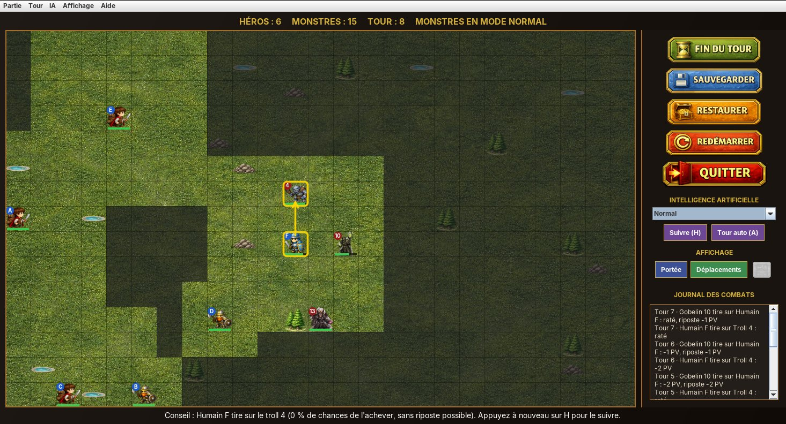
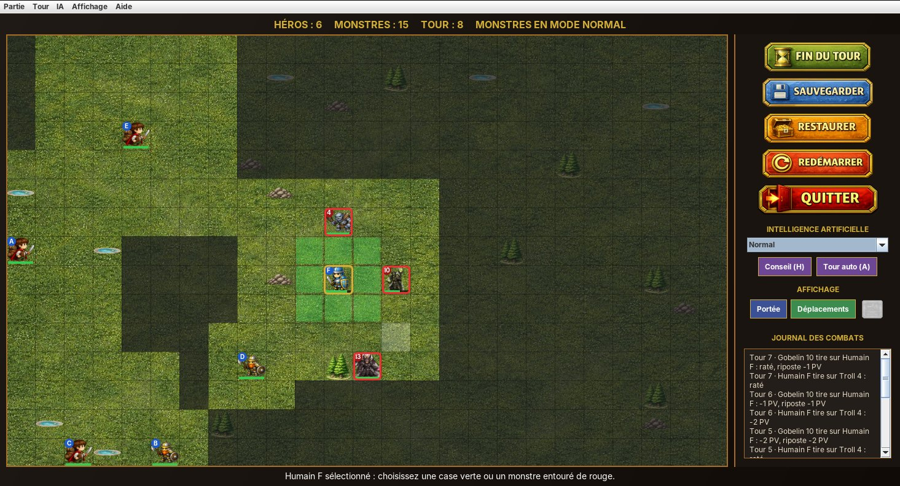

# Wargame : la bataille de la Terre du Milieu (Java, Swing)

Jeu de stratégie au tour par tour en **Java** avec une interface **Swing**. Votre armée de héros (humains, nains, elfes, hobbits) affronte l'armée de monstres (trolls, orcs, gobelins) dirigée par l'ordinateur, sur une carte avec obstacles et brouillard de guerre.

Projet de programmation orientée objet de Licence 3 Informatique (Université Jean Monnet, Saint-Étienne), repris et complété avec des fonctionnalités d'**intelligence artificielle** :
- **trois niveaux d'IA** pour les monstres, dont une IA tactique avec recherche de chemin ;
- un **conseiller IA** pour le joueur, qui propose et explique le meilleur coup ;
- un **tour automatique**, où l'IA joue à votre place.



## Lancer le jeu

Il faut Java 17 ou plus.

```bash
./build.sh                 # compile et crée wargame.jar
java -jar wargame.jar
```

Sans le script (sous Windows, par exemple) :

```bash
javac -encoding UTF-8 -d build src/wargame/*.java
cp -r src/wargame/images src/wargame/sound.wav build/wargame/
java -cp build wargame.FenetreJeu
```

## Règles

- **But** : éliminer tous les monstres avant qu'ils n'éliminent vos héros.
- **Un ordre par héros et par tour** :
  - se **déplacer** d'une case, diagonales comprises ;
  - **attaquer** un monstre au contact, ou à distance pour les héros qui savent tirer : la cible doit être à portée, sans rocher ni forêt sur la trajectoire (l'eau ne bloque pas les tirs) ;
  - ou ne rien faire : le héros **se repose** et regagne 2 points de vie.
- **Combats** : l'attaquant frappe en premier, la cible riposte si elle survit **et** si elle peut atteindre l'attaquant. Un troll ne répond donc pas à une flèche tirée de loin.
- **Brouillard de guerre** : les cases hors de vue de vos héros sont grisées, et les monstres qui s'y trouvent sont invisibles.

| Héros | PV | Portée | Frappe | Tir | | Monstres | PV | Portée | Frappe | Tir |
|---|---|---|---|---|---|---|---|---|---|---|
| Humain | 40 | 3 | 10 | 2 | | Troll | 100 | 1 | 30 | 0 |
| Nain | 80 | 1 | 20 | 0 | | Orc | 40 | 2 | 10 | 3 |
| Elfe | 70 | 5 | 10 | 6 | | Gobelin | 20 | 2 | 5 | 2 |
| Hobbit | 20 | 3 | 5 | 2 | | | | | | |

**Commandes**
- **Souris** : glissez un héros vers la case visée, ou cliquez sur le héros puis sur la case. Les cases accessibles s'affichent en vert, les monstres attaquables entourés de rouge.
- **Infobulle** : survolez un soldat pour voir ses détails.

| Touche | Action | Touche | Action |
|---|---|---|---|
| Espace | Fin du tour | P | Portée du soldat survolé |
| H | Conseil de l'IA (H à nouveau pour le suivre) | D | Déplacements du héros survolé |
| A | Tour automatique | M | Musique |
| Échap | Annuler la sélection | Ctrl+S / Ctrl+R / Ctrl+N | Sauvegarder / restaurer / nouvelle partie |



## Intelligence artificielle

### Trois stratégies pour les monstres

Le général-ordinateur utilise le patron de conception **Stratégie** : l'interface `StrategieMonstres` a trois implémentations. On change de niveau à tout moment, depuis le menu ou le menu latéral.

| Niveau | Classe | Comportement |
|---|---|---|
| Facile | `StrategieAleatoire` | Le comportement demandé par le sujet : attaque si un héros est à portée, sinon déplacement au hasard |
| Normal | `StrategieGloutonne` | Vise le héros visible le plus faible et le plus proche, puis s'en rapproche en ligne droite |
| Difficile | `StrategieTactique` | Voir ci-dessous |

La stratégie **Difficile** :
- **Vision partagée et mémoire** : chaque monstre sait ce que voit toute l'armée des monstres, et se souvient de la dernière position des héros. Quand personne n'est en vue, l'armée fouille les zones inconnues, en commençant par le camp des héros.
- **Choix de la cible** : chaque attaque possible reçoit une note qui combine la probabilité d'achever le héros, les dégâts attendus, le danger que représente ce héros et la riposte probable. Les monstres concentrent donc leurs coups sur les héros affaiblis.
- **Recherche de chemin** : un parcours en largeur calcule le chemin le plus court vers une case d'où le monstre pourra attaquer, en contournant les obstacles. C'est une case voisine du héros pour un troll, et une case à portée avec une ligne de vue dégagée pour un orc archer. À distance égale, le monstre choisit la case la moins exposée.
- **Repos** : un monstre gravement blessé et hors de danger se repose au lieu d'avancer.

### Le conseiller du joueur

La classe `Conseiller` évalue toutes les actions possibles de chaque héros (attaques, 8 déplacements, repos) avec les seules informations que voient les héros :
- **une attaque** vaut par ses chances d'achever le monstre, les dégâts attendus et la menace que représente le monstre, moins la riposte probable ;
- **un déplacement** vaut par la position d'attaque gagnée pour le tour suivant, ou par le danger évité quand le héros est blessé. Quand aucun monstre n'est en vue, les héros explorent le brouillard ;
- **le repos** vaut par les points de vie regagnés quand le héros est à l'abri.

Le meilleur coup s'affiche par une **flèche dorée** sur la carte, avec une phrase d'explication. Par exemple : « Elfe C tire sur le troll 4 (40 % de chances de l'achever, sans riposte possible) ». Le **tour automatique** applique ces conseils un par un pour tous les héros, en réévaluant la situation après chaque action.

### Mesure de la force des IA

`Simulation` fait jouer des parties sans interface, avec les mêmes 200 cartes pour chaque niveau (`./build.sh simu`). Une partie qui dépasse 300 tours est déclarée nulle.

| Monstres | Héros joués par | Héros gagnent | Monstres gagnent | Nulles | Tours en moyenne |
|---|---|---|---|---|---|
| Facile | personne (repos) | 0 % | 40,5 % | 119 | 256 |
| Facile | le conseiller | **19,0 %** | 51,5 % | 59 | 192 |
| Normal | personne (repos) | 0 % | 46,5 % | 107 | 252 |
| Normal | le conseiller | **15,5 %** | 55,5 % | 58 | 188 |
| Difficile | personne (repos) | 0 % | 67,0 % | 66 | 130 |
| Difficile | le conseiller | **2,0 %** | 94,5 % | 7 | 45 |

Trois constats :
- **Les niveaux se distinguent nettement.** Face au même joueur, l'IA difficile gagne 94,5 % des parties en 45 tours en moyenne, contre environ 55 % pour les deux autres.
- **Le conseiller est le seul moyen de gagner.** Des héros passifs ne gagnent jamais : au mieux, la partie est nulle quand les monstres ne les trouvent pas.
- **Le jeu reste difficile pour les héros**, car le sujet impose 15 monstres contre 6 héros.

## Organisation du code

```
src/wargame/
├── IConfig, ISoldat, ICarte          paramètres et interfaces fournis par le sujet
├── Element ← Obstacle, Soldat ← Heros, Monstre    hiérarchie des éléments de la carte
├── Position, Carte                   grille, règles, ligne de vue, vision, parcours en largeur, sauvegarde
├── Difficulte, StrategieMonstres     niveaux et interface du patron Stratégie
│   ├── StrategieAleatoire
│   ├── StrategieGloutonne
│   └── StrategieTactique
├── Conseiller                        IA du joueur (conseil et tour automatique)
├── FenetreJeu, PanneauJeu            interface Swing
├── Hasard                            hasard à graine fixable (parties reproductibles)
├── Simulation                        IA contre IA, sans interface
├── TestWargame                       50 tests
└── *Exception                        CarteException, PositionException, SoldatException, SauvegardeException
```

Techniques de programmation orientée objet utilisées :
- **héritage** : `Element` → `Soldat` → `Heros` / `Monstre` ;
- **classes abstraites et interfaces** ;
- **polymorphisme** : les stratégies, `getNomType()`, `identifiant()` ;
- **types énumérés** avec données et comportement (`TypesH`, `TypesM`, `Difficulte`) ;
- **encapsulation** ;
- **exceptions personnalisées** ;
- **sérialisation** pour les sauvegardes.

## Tests

```bash
./build.sh test    # 50 tests
```

Les tests couvrent :
- **Les règles** : déplacements, actions refusées, corps-à-corps en diagonale, portée et ligne de vue (forêt et rocher bloquent, l'eau non), riposte, mort, repos, fin de tour, brouillard de guerre.
- **L'IA** : contournement d'un mur par le troll, choix du héros le plus faible, repos d'un monstre blessé, choix du conseiller.
- **Le reste** : une partie complète à chaque niveau, et la sauvegarde (restauration, sauvegarde inexistante, nom de fichier dangereux).

La Javadoc se génère avec `./build.sh doc`.

## Corrections par rapport à la version rendue

La [première version du dépôt](../../tree/0b84cdd) contient le code tel qu'il a été rendu.

| Problème de la version d'origine | Correction |
|---|---|
| Brouillard de guerre absent (demandé par le sujet) : les monstres étaient visibles partout | Cases hors de vue grisées, monstres invisibles dans le brouillard |
| La musique était lue depuis un fichier à côté du jeu : rien ne se lisait depuis le `.jar`. Sans carte son, une fenêtre d'erreur bloquait le lancement | Lecture depuis le `.jar`. Sans son, le jeu démarre normalement |
| Le corps-à-corps n'était pas reconnu en diagonale (distance de Manhattan) alors que les déplacements se font en diagonale : un nain ne pouvait pas frapper un monstre qui le touchait en diagonale | Distance en cases, diagonales comprises, partout |
| La cible ripostait même hors de portée (un troll répondait à une flèche tirée de loin) | La cible ne riposte que si elle peut atteindre l'attaquant |
| Images des soldats attribuées au hasard : un troll pouvait avoir l'image d'un gobelin, et rien n'identifiait les unités | Image selon le type, lettre ou numéro sur chaque unité |
| Barre de vie dessinée au-dessus de la case, hors de la carte pour la première ligne | Barre de vie dans la case |
| Les soldats morts restaient dans les listes jusqu'à la fin du tour | Retirés immédiatement |
| La partie continuait après la victoire ou la défaite | La carte est bloquée et une nouvelle partie est proposée |
| `equals` et `hashCode` des soldats basés sur l'identité, avec un code trompeur | Supprimés : l'identité suffit |
| Un nom de sauvegarde pouvait écrire n'importe où (`../`) | Noms contrôlés, sauvegardes dans `sauvegardes/` |
| Code mort (ancienne IA, méthodes inutilisées) et tests qui affichaient des résultats sans rien vérifier | Code nettoyé, 50 tests automatiques |
| Paquet de 9 Mo | 2 Mo (images et musique compressées) |

Ajouts :
- trois niveaux d'IA, le conseiller et le tour automatique ;
- la simulation ;
- le clic en deux temps en plus du glisser-déposer ;
- le journal des combats et les infobulles ;
- de nouveaux raccourcis clavier.

## Crédits

Projet de L3 réalisé en équipe ; cette version reprise et améliorée est de **Majd CHAMAS**. Musique : *The Old Tower Inn* de RandomMind (domaine public).
